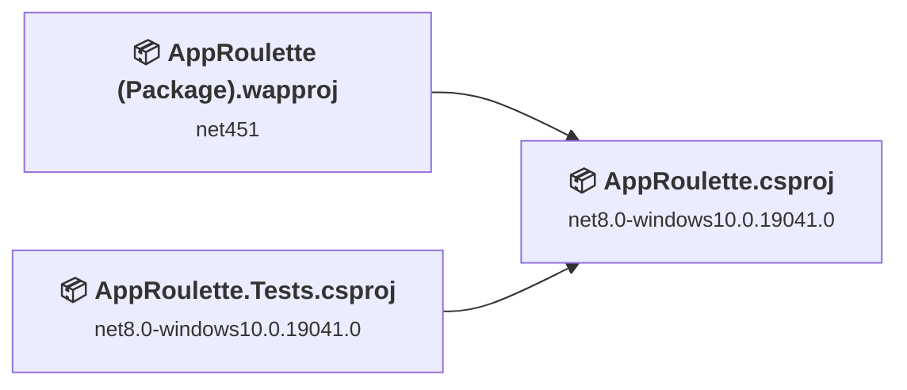
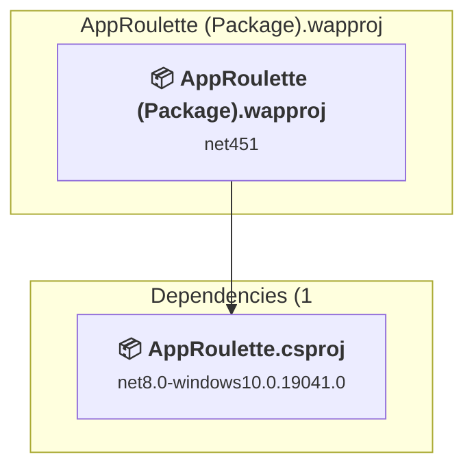
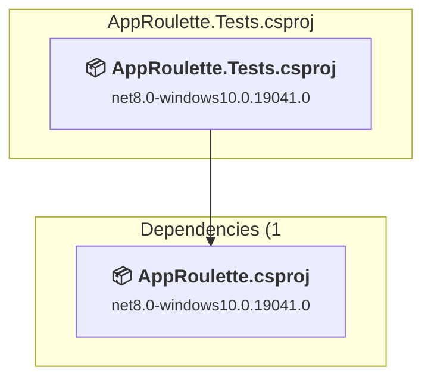
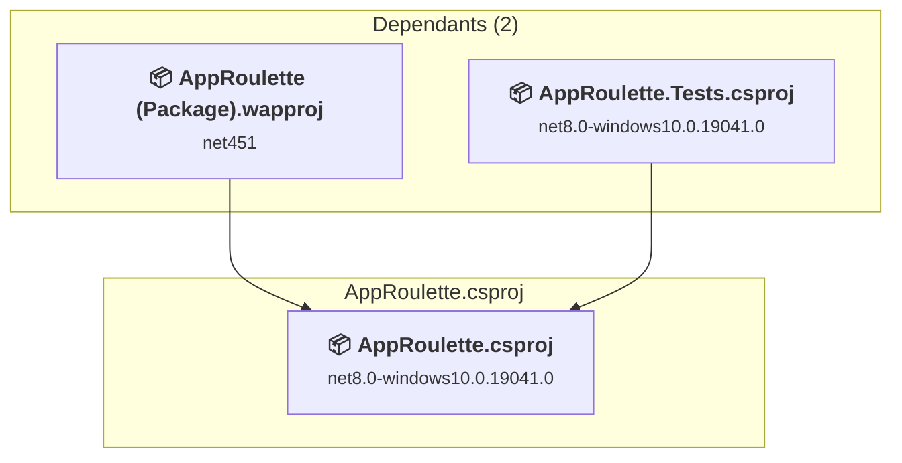

# Projects and dependencies analysis

This document provides a comprehensive overview of the projects and their dependencies in the context of upgrading to .NETCoreApp,Version=v10.0.

## Table of Contents

- [Executive Summary](#executive-Summary)
  - [Highlevel Metrics](#highlevel-metrics)
  - [Projects Compatibility](#projects-compatibility)
  - [Package Compatibility](#package-compatibility)
  - [API Compatibility](#api-compatibility)
  - [Binding Redirect Configuration](#binding-redirect-configuration)
- [Aggregate NuGet packages details](#aggregate-nuget-packages-details)
- [Top API Migration Challenges](#top-api-migration-challenges)
  - [Technologies and Features](#technologies-and-features)
  - [Most Frequent API Issues](#most-frequent-api-issues)
- [Projects Relationship Graph](#projects-relationship-graph)
- [Project Details](#project-details)

  - [AppRoulette\AppRoulette (Package)\AppRoulette (Package).wapproj](#approuletteapproulette-(package)approulette-(package)wapproj)
  - [AppRoulette\AppRoulette.Tests\AppRoulette.Tests.csproj](#approuletteapproulettetestsapproulettetestscsproj)
  - [AppRoulette\AppRoulette\AppRoulette.csproj](#approuletteapprouletteapproulettecsproj)

## Executive Summary

### Highlevel Metrics

| Metric | Count | Status |
| :--- | :---: | :--- |
| Total Projects | 3 | All require upgrade |
| Total NuGet Packages | 47 | 3 need upgrade |
| Total Code Files | 43 |  |
| Total Code Files with Incidents | 8 |  |
| Total Lines of Code | 7799 |  |
| Total Number of Issues | 42 |  |
| Estimated LOC to modify | 36+ | at least 0.5% of codebase |

### Projects Compatibility

| Project | Target Framework | Difficulty | Package Issues | API Issues | Binding Issues | Est. LOC Impact | Description |
| :--- | :---: | :---: | :---: | :---: | :---: | :---: | :--- |
| [AppRoulette\AppRoulette (Package)\AppRoulette (Package).wapproj](#approuletteapproulette-(package)approulette-(package)wapproj) | net451 | 🟢 Low | 0 | 0 | 0 |  | WinUI, Sdk Style = True |
| [AppRoulette\AppRoulette.Tests\AppRoulette.Tests.csproj](#approuletteapproulettetestsapproulettetestscsproj) | net8.0-windows10.0.19041.0 | 🟢 Low | 1 | 0 | 0 |  | WinUI, Sdk Style = True |
| [AppRoulette\AppRoulette\AppRoulette.csproj](#approuletteapprouletteapproulettecsproj) | net8.0-windows10.0.19041.0 | 🟢 Low | 2 | 36 | 0 | 36+ | WinForms, Sdk Style = True |

### Package Compatibility

| Status | Count | Percentage |
| :--- | :---: | :---: |
| ✅ Compatible | 44 | 93.6% |
| ⚠️ Incompatible | 2 | 4.3% |
| 🔄 Upgrade Recommended | 1 | 2.1% |
| ***Total NuGet Packages*** | ***47*** | ***100%*** |

### API Compatibility

| Category | Count | Impact |
| :--- | :---: | :--- |
| 🔴 Binary Incompatible | 0 | High - Require code changes |
| 🟡 Source Incompatible | 32 | Medium - Needs re-compilation and potential conflicting API error fixing |
| 🔵 Behavioral change | 4 | Low - Behavioral changes that may require testing at runtime |
| ✅ Compatible | 7932 |  |
| ***Total APIs Analyzed*** | ***7968*** |  |

## Aggregate NuGet packages details

| Package | Current Version | Suggested Version | Projects | Description |
| :--- | :---: | :---: | :--- | :--- |
| CommunityToolkit.Mvvm | 8.4.2 |  | [AppRoulette (Package).wapproj](#approuletteapproulette-(package)approulette-(package)wapproj) [AppRoulette.csproj](#approuletteapprouletteapproulettecsproj) [AppRoulette.Tests.csproj](#approuletteapproulettetestsapproulettetestscsproj) | ✅Compatible |
| Microsoft.Bcl.AsyncInterfaces | 10.0.1 |  | [AppRoulette (Package).wapproj](#approuletteapproulette-(package)approulette-(package)wapproj) | ✅Compatible |
| Microsoft.Bcl.Numerics | 9.0.0 |  | [AppRoulette (Package).wapproj](#approuletteapproulette-(package)approulette-(package)wapproj) | ✅Compatible |
| Microsoft.CodeCoverage | 18.6.0 |  | [AppRoulette.Tests.csproj](#approuletteapproulettetestsapproulettetestscsproj) | ✅Compatible |
| Microsoft.Data.Sqlite | 8.0.0 | 10.0.11 | [AppRoulette (Package).wapproj](#approuletteapproulette-(package)approulette-(package)wapproj) [AppRoulette.csproj](#approuletteapprouletteapproulettecsproj) [AppRoulette.Tests.csproj](#approuletteapproulettetestsapproulettetestscsproj) | NuGet パッケージのアップグレードをおすすめします |
| Microsoft.Data.Sqlite.Core | 8.0.0 |  | [AppRoulette (Package).wapproj](#approuletteapproulette-(package)approulette-(package)wapproj) [AppRoulette.csproj](#approuletteapprouletteapproulettecsproj) [AppRoulette.Tests.csproj](#approuletteapproulettetestsapproulettetestscsproj) | ✅Compatible |
| Microsoft.Graphics.Win2D | 1.4.0 | 1.1.0 | [AppRoulette (Package).wapproj](#approuletteapproulette-(package)approulette-(package)wapproj) [AppRoulette.csproj](#approuletteapprouletteapproulettecsproj) [AppRoulette.Tests.csproj](#approuletteapproulettetestsapproulettetestscsproj) | ⚠️NuGet パッケージに互換性がありません |
| Microsoft.NET.Test.Sdk | 18.6.0 |  | [AppRoulette.Tests.csproj](#approuletteapproulettetestsapproulettetestscsproj) | ✅Compatible |
| Microsoft.TestPlatform.ObjectModel | 18.6.0 |  | [AppRoulette.Tests.csproj](#approuletteapproulettetestsapproulettetestscsproj) | ✅Compatible |
| Microsoft.TestPlatform.TestHost | 18.6.0 |  | [AppRoulette.Tests.csproj](#approuletteapproulettetestsapproulettetestscsproj) | ✅Compatible |
| Microsoft.Web.WebView2 | 1.0.3719.77 |  | [AppRoulette (Package).wapproj](#approuletteapproulette-(package)approulette-(package)wapproj) [AppRoulette.csproj](#approuletteapprouletteapproulettecsproj) [AppRoulette.Tests.csproj](#approuletteapproulettetestsapproulettetestscsproj) | ✅Compatible |
| Microsoft.Windows.AI.MachineLearning | 2.1.70 |  | [AppRoulette (Package).wapproj](#approuletteapproulette-(package)approulette-(package)wapproj) [AppRoulette.csproj](#approuletteapprouletteapproulettecsproj) [AppRoulette.Tests.csproj](#approuletteapproulettetestsapproulettetestscsproj) | ✅Compatible |
| Microsoft.Windows.SDK.BuildTools | 10.0.28000.1839 |  | [AppRoulette (Package).wapproj](#approuletteapproulette-(package)approulette-(package)wapproj) [AppRoulette.csproj](#approuletteapprouletteapproulettecsproj) [AppRoulette.Tests.csproj](#approuletteapproulettetestsapproulettetestscsproj) | ✅Compatible |
| Microsoft.Windows.SDK.BuildTools.MSIX | 1.7.251221100 |  | [AppRoulette (Package).wapproj](#approuletteapproulette-(package)approulette-(package)wapproj) [AppRoulette.csproj](#approuletteapprouletteapproulettecsproj) [AppRoulette.Tests.csproj](#approuletteapproulettetestsapproulettetestscsproj) | ✅Compatible |
| Microsoft.WindowsAppSDK | 2.2.0 |  | [AppRoulette (Package).wapproj](#approuletteapproulette-(package)approulette-(package)wapproj) [AppRoulette.csproj](#approuletteapprouletteapproulettecsproj) [AppRoulette.Tests.csproj](#approuletteapproulettetestsapproulettetestscsproj) | ✅Compatible |
| Microsoft.WindowsAppSDK.AI | 2.2.3 |  | [AppRoulette (Package).wapproj](#approuletteapproulette-(package)approulette-(package)wapproj) [AppRoulette.csproj](#approuletteapprouletteapproulettecsproj) [AppRoulette.Tests.csproj](#approuletteapproulettetestsapproulettetestscsproj) | ✅Compatible |
| Microsoft.WindowsAppSDK.Base | 2.0.4 |  | [AppRoulette (Package).wapproj](#approuletteapproulette-(package)approulette-(package)wapproj) [AppRoulette.csproj](#approuletteapprouletteapproulettecsproj) [AppRoulette.Tests.csproj](#approuletteapproulettetestsapproulettetestscsproj) | ✅Compatible |
| Microsoft.WindowsAppSDK.DWrite | 2.1.0 |  | [AppRoulette (Package).wapproj](#approuletteapproulette-(package)approulette-(package)wapproj) [AppRoulette.csproj](#approuletteapprouletteapproulettecsproj) [AppRoulette.Tests.csproj](#approuletteapproulettetestsapproulettetestscsproj) | ✅Compatible |
| Microsoft.WindowsAppSDK.Foundation | 2.1.0 |  | [AppRoulette (Package).wapproj](#approuletteapproulette-(package)approulette-(package)wapproj) [AppRoulette.csproj](#approuletteapprouletteapproulettecsproj) [AppRoulette.Tests.csproj](#approuletteapproulettetestsapproulettetestscsproj) | ✅Compatible |
| Microsoft.WindowsAppSDK.InteractiveExperiences | 2.0.15 |  | [AppRoulette (Package).wapproj](#approuletteapproulette-(package)approulette-(package)wapproj) [AppRoulette.csproj](#approuletteapprouletteapproulettecsproj) [AppRoulette.Tests.csproj](#approuletteapproulettetestsapproulettetestscsproj) | ✅Compatible |
| Microsoft.WindowsAppSDK.ML | 2.1.70 |  | [AppRoulette (Package).wapproj](#approuletteapproulette-(package)approulette-(package)wapproj) [AppRoulette.csproj](#approuletteapprouletteapproulettecsproj) [AppRoulette.Tests.csproj](#approuletteapproulettetestsapproulettetestscsproj) | ✅Compatible |
| Microsoft.WindowsAppSDK.Runtime | 2.2.0 |  | [AppRoulette (Package).wapproj](#approuletteapproulette-(package)approulette-(package)wapproj) [AppRoulette.csproj](#approuletteapprouletteapproulettecsproj) [AppRoulette.Tests.csproj](#approuletteapproulettetestsapproulettetestscsproj) | ✅Compatible |
| Microsoft.WindowsAppSDK.Widgets | 2.0.5 |  | [AppRoulette (Package).wapproj](#approuletteapproulette-(package)approulette-(package)wapproj) [AppRoulette.csproj](#approuletteapprouletteapproulettecsproj) [AppRoulette.Tests.csproj](#approuletteapproulettetestsapproulettetestscsproj) | ✅Compatible |
| Microsoft.WindowsAppSDK.WinUI | 2.2.1 |  | [AppRoulette (Package).wapproj](#approuletteapproulette-(package)approulette-(package)wapproj) [AppRoulette.csproj](#approuletteapprouletteapproulettecsproj) [AppRoulette.Tests.csproj](#approuletteapproulettetestsapproulettetestscsproj) | ✅Compatible |
| Newtonsoft.Json | 13.0.3 |  | [AppRoulette.Tests.csproj](#approuletteapproulettetestsapproulettetestscsproj) | ✅Compatible |
| SQLitePCLRaw.bundle_e_sqlite3 | 2.1.6 |  | [AppRoulette (Package).wapproj](#approuletteapproulette-(package)approulette-(package)wapproj) [AppRoulette.csproj](#approuletteapprouletteapproulettecsproj) [AppRoulette.Tests.csproj](#approuletteapproulettetestsapproulettetestscsproj) | ✅Compatible |
| SQLitePCLRaw.core | 2.1.6 |  | [AppRoulette (Package).wapproj](#approuletteapproulette-(package)approulette-(package)wapproj) [AppRoulette.csproj](#approuletteapprouletteapproulettecsproj) [AppRoulette.Tests.csproj](#approuletteapproulettetestsapproulettetestscsproj) | ✅Compatible |
| SQLitePCLRaw.lib.e_sqlite3 | 2.1.6 |  | [AppRoulette (Package).wapproj](#approuletteapproulette-(package)approulette-(package)wapproj) [AppRoulette.csproj](#approuletteapprouletteapproulettecsproj) [AppRoulette.Tests.csproj](#approuletteapproulettetestsapproulettetestscsproj) | ✅Compatible |
| SQLitePCLRaw.provider.e_sqlite3 | 2.1.6 |  | [AppRoulette (Package).wapproj](#approuletteapproulette-(package)approulette-(package)wapproj) [AppRoulette.csproj](#approuletteapprouletteapproulettecsproj) [AppRoulette.Tests.csproj](#approuletteapproulettetestsapproulettetestscsproj) | ✅Compatible |
| System.Buffers | 4.6.1 |  | [AppRoulette (Package).wapproj](#approuletteapproulette-(package)approulette-(package)wapproj) | ✅Compatible |
| System.Collections.Immutable | 8.0.0 |  | [AppRoulette.Tests.csproj](#approuletteapproulettetestsapproulettetestscsproj) | ✅Compatible |
| System.ComponentModel.Annotations | 5.0.0 |  | [AppRoulette (Package).wapproj](#approuletteapproulette-(package)approulette-(package)wapproj) | ✅Compatible |
| System.Memory | 4.5.3 |  | [AppRoulette.csproj](#approuletteapprouletteapproulettecsproj) [AppRoulette.Tests.csproj](#approuletteapproulettetestsapproulettetestscsproj) | ✅Compatible |
| System.Memory | 4.6.3 |  | [AppRoulette (Package).wapproj](#approuletteapproulette-(package)approulette-(package)wapproj) | ✅Compatible |
| System.Numerics.Tensors | 9.0.0 |  | [AppRoulette (Package).wapproj](#approuletteapproulette-(package)approulette-(package)wapproj) [AppRoulette.csproj](#approuletteapprouletteapproulettecsproj) [AppRoulette.Tests.csproj](#approuletteapproulettetestsapproulettetestscsproj) | ✅Compatible |
| System.Numerics.Vectors | 4.6.1 |  | [AppRoulette (Package).wapproj](#approuletteapproulette-(package)approulette-(package)wapproj) | ✅Compatible |
| System.Reflection.Metadata | 8.0.0 |  | [AppRoulette.Tests.csproj](#approuletteapproulettetestsapproulettetestscsproj) | ✅Compatible |
| System.Runtime.CompilerServices.Unsafe | 6.1.2 |  | [AppRoulette (Package).wapproj](#approuletteapproulette-(package)approulette-(package)wapproj) | ✅Compatible |
| System.Threading.Tasks.Extensions | 4.6.3 |  | [AppRoulette (Package).wapproj](#approuletteapproulette-(package)approulette-(package)wapproj) | ✅Compatible |
| xunit | 2.9.3 |  | [AppRoulette.Tests.csproj](#approuletteapproulettetestsapproulettetestscsproj) | ⚠️NuGet パッケージは非推奨です |
| xunit.abstractions | 2.0.3 |  | [AppRoulette.Tests.csproj](#approuletteapproulettetestsapproulettetestscsproj) | ✅Compatible |
| xunit.analyzers | 1.18.0 |  | [AppRoulette.Tests.csproj](#approuletteapproulettetestsapproulettetestscsproj) | ✅Compatible |
| xunit.assert | 2.9.3 |  | [AppRoulette.Tests.csproj](#approuletteapproulettetestsapproulettetestscsproj) | ✅Compatible |
| xunit.core | 2.9.3 |  | [AppRoulette.Tests.csproj](#approuletteapproulettetestsapproulettetestscsproj) | ✅Compatible |
| xunit.extensibility.core | 2.9.3 |  | [AppRoulette.Tests.csproj](#approuletteapproulettetestsapproulettetestscsproj) | ✅Compatible |
| xunit.extensibility.execution | 2.9.3 |  | [AppRoulette.Tests.csproj](#approuletteapproulettetestsapproulettetestscsproj) | ✅Compatible |
| xunit.runner.visualstudio | 2.8.2 |  | [AppRoulette.Tests.csproj](#approuletteapproulettetestsapproulettetestscsproj) | ✅Compatible |

## Top API Migration Challenges

### Technologies and Features

| Technology | Issues | Percentage | Migration Path |
| :--- | :---: | :---: | :--- |

### Most Frequent API Issues

| API | Count | Percentage | Category |
| :--- | :---: | :---: | :--- |
| T:Windows.UI.Color | 24 | 66.7% | Source Incompatible |
| T:System.Uri | 2 | 5.6% | Behavioral Change |
| M:System.Uri.#ctor(System.String) | 2 | 5.6% | Behavioral Change |
| M:Windows.UI.Color.FromArgb(System.Byte,System.Byte,System.Byte,System.Byte) | 2 | 5.6% | Source Incompatible |
| M:System.TimeSpan.FromMilliseconds(System.Double) | 2 | 5.6% | Source Incompatible |
| T:Windows.Foundation.Size | 1 | 2.8% | Source Incompatible |
| P:Windows.Foundation.Point.Y | 1 | 2.8% | Source Incompatible |
| P:Windows.Foundation.Point.X | 1 | 2.8% | Source Incompatible |
| T:Windows.Foundation.Point | 1 | 2.8% | Source Incompatible |

## Projects Relationship Graph

Legend:
📦 SDK-style project
⚙️ Classic project

## Project Details

### AppRoulette\AppRoulette (Package)\AppRoulette (Package).wapproj

#### Project Info

- **Current Target Framework:** net451
- **Proposed Target Framework:** net10.0-windows10.0.26100.0
- **SDK-style**: True
- **Project Kind:** WinUI
- **Dependencies**: 1
- **Dependants**: 0
- **Number of Files**: 7
- **Number of Files with Incidents**: 1
- **Lines of Code**: 0
- **Estimated LOC to modify**: 0+ (at least 0.0% of the project)

#### Dependency Graph

Legend:
📦 SDK-style project
⚙️ Classic project

### API Compatibility

| Category | Count | Impact |
| :--- | :---: | :--- |
| 🔴 Binary Incompatible | 0 | High - Require code changes |
| 🟡 Source Incompatible | 0 | Medium - Needs re-compilation and potential conflicting API error fixing |
| 🔵 Behavioral change | 0 | Low - Behavioral changes that may require testing at runtime |
| ✅ Compatible | 0 |  |
| ***Total APIs Analyzed*** | ***0*** |  |

### AppRoulette\AppRoulette.Tests\AppRoulette.Tests.csproj

#### Project Info

- **Current Target Framework:** net8.0-windows10.0.19041.0
- **Proposed Target Framework:** net10.0-windows10.0.22000.0
- **SDK-style**: True
- **Project Kind:** WinUI
- **Dependencies**: 1
- **Dependants**: 0
- **Number of Files**: 15
- **Number of Files with Incidents**: 1
- **Lines of Code**: 2413
- **Estimated LOC to modify**: 0+ (at least 0.0% of the project)

#### Dependency Graph

Legend:
📦 SDK-style project
⚙️ Classic project

### API Compatibility

| Category | Count | Impact |
| :--- | :---: | :--- |
| 🔴 Binary Incompatible | 0 | High - Require code changes |
| 🟡 Source Incompatible | 0 | Medium - Needs re-compilation and potential conflicting API error fixing |
| 🔵 Behavioral change | 0 | Low - Behavioral changes that may require testing at runtime |
| ✅ Compatible | 2537 |  |
| ***Total APIs Analyzed*** | ***2537*** |  |

### AppRoulette\AppRoulette\AppRoulette.csproj

#### Project Info

- **Current Target Framework:** net8.0-windows10.0.19041.0
- **Proposed Target Framework:** net10.0-windows10.0.22000.0
- **SDK-style**: True
- **Project Kind:** WinForms
- **Dependencies**: 0
- **Dependants**: 2
- **Number of Files**: 30
- **Number of Files with Incidents**: 6
- **Lines of Code**: 5386
- **Estimated LOC to modify**: 36+ (at least 0.7% of the project)

#### Dependency Graph

Legend:
📦 SDK-style project
⚙️ Classic project

### API Compatibility

| Category | Count | Impact |
| :--- | :---: | :--- |
| 🔴 Binary Incompatible | 0 | High - Require code changes |
| 🟡 Source Incompatible | 32 | Medium - Needs re-compilation and potential conflicting API error fixing |
| 🔵 Behavioral change | 4 | Low - Behavioral changes that may require testing at runtime |
| ✅ Compatible | 5395 |  |
| ***Total APIs Analyzed*** | ***5431*** |  |

